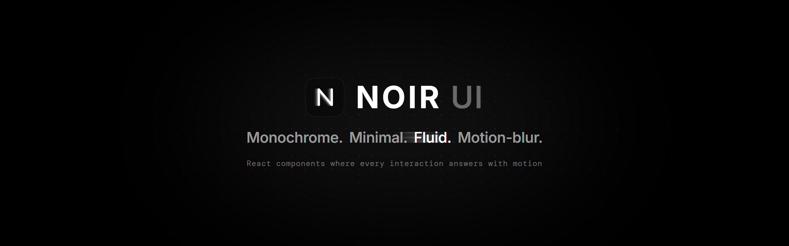
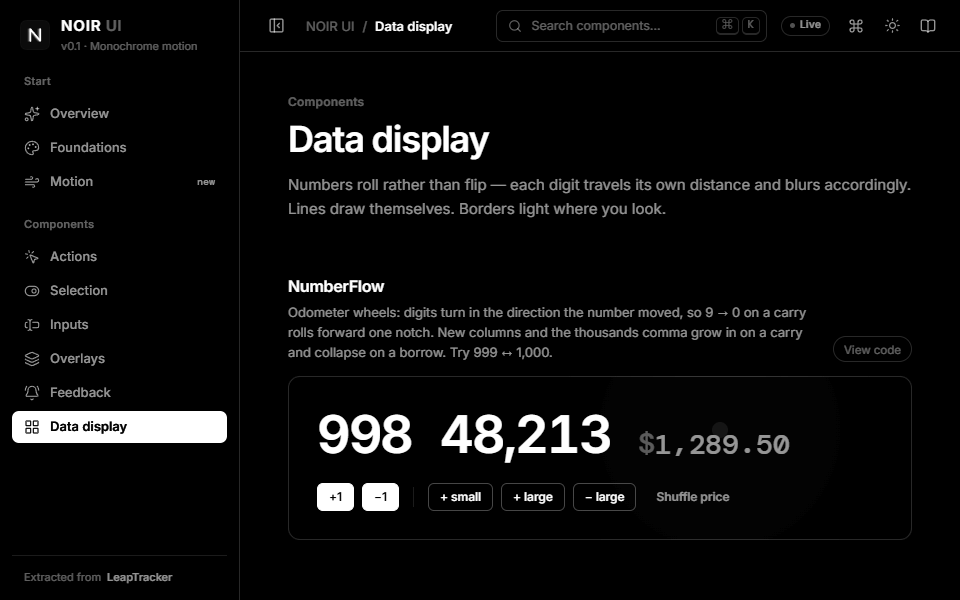
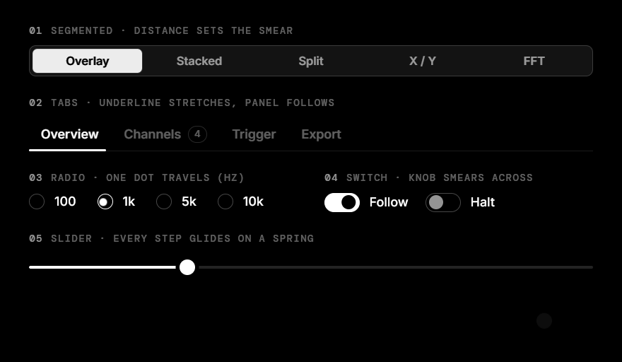
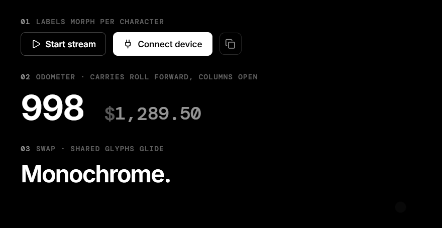
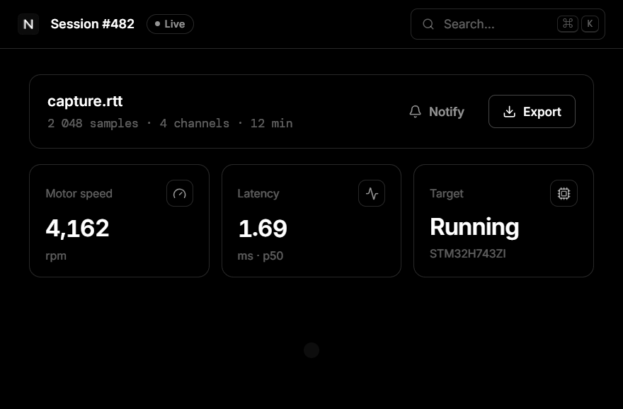
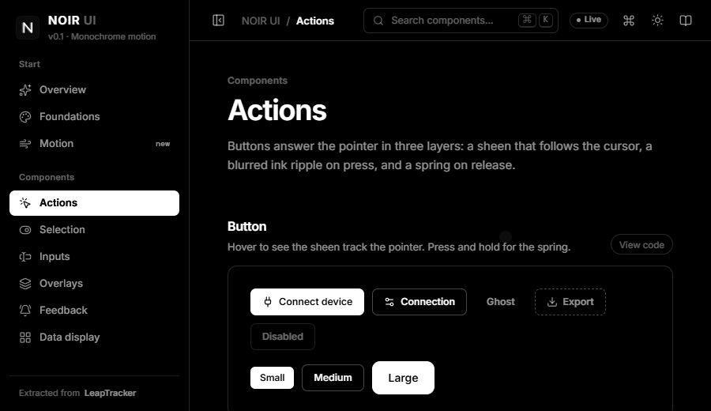
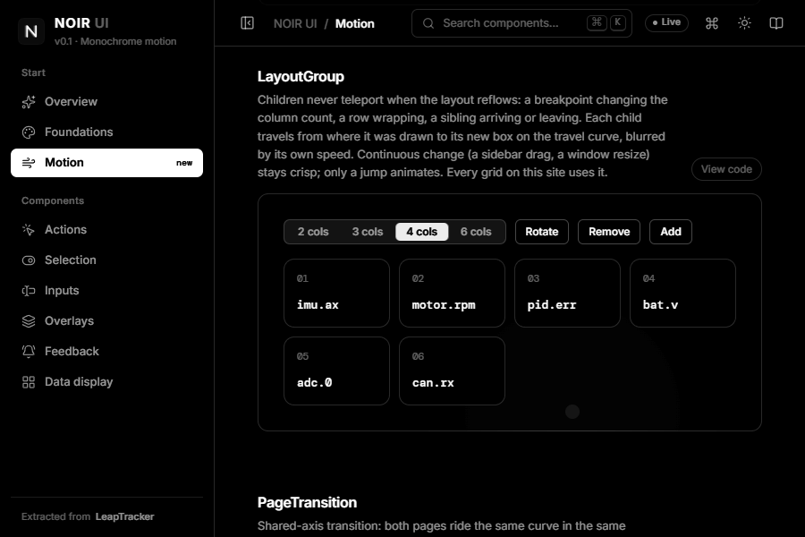
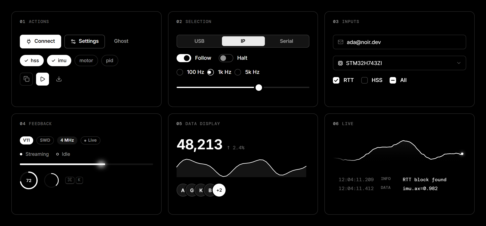

<div align="center">

<picture>
  <source media="(prefers-color-scheme: light)" srcset=".github/assets/banner-light.png">
  
</picture>

<br/>

**A React component library where every interaction answers with motion blur.**<br/>
Two inks, hairline surfaces, and movement that smears along its own velocity — then lands sharp.

<br/>


[English](README.md) · [简体中文](README.zh-CN.md)

</div>

<br/>

<p align="center">
  
</p>

<br/>

## Why NOIR

<table>
<tr>
<td width="33%" valign="top">

**Monochrome**

`#000` and `#fff` and a ladder of alpha. Hierarchy comes from weight, spacing and motion — never from hue.

</td>
<td width="33%" valign="top">

**Velocity, not keyframes**

Blur and stretch are computed from each element's *instantaneous* speed, so smear peaks exactly when something is fastest and is gone as it lands.

</td>
<td width="33%" valign="top">

**Continuity**

Nothing pops. Labels morph per glyph, digits roll like an odometer, surfaces resolve from blur toward their anchor, and interrupted motion continues from the live frame.

</td>
</tr>
</table>

<br/>

## Motion

### One object travels — it never teleports



Segmented, Tabs, NavList, ListBox and RadioGroup share a single travelling indicator. It moves on one curve, stretches toward its trailing edge and blurs by its sampled speed. Solid thumbs invert the labels beneath them per pixel (`mix-blend-mode: difference`), so text flips exactly where the ink is. Every Slider step glides on a critically damped spring.

### Labels morph per character



`Swap` measures every glyph (kerning included). Glyphs the two labels share glide to their new place; the rest roll out and in with a stagger. At rest it is plain text, so selection and screen readers are untouched. `NumberFlow` turns digits like odometer wheels, in the direction the value moved. On a carry, the new column and the thousands comma open in place.

### Surfaces resolve toward their anchor



Menus and popovers smear in from the side they open on, and their rows trail in after them. Toasts stack into a deck that fans open on hover and can be swiped away; `toast.promise` morphs one toast from loading to done. The command palette fuzzy-filters with a gliding highlight, and its height tweens with the result count.

### A sidebar with weight



`Sidebar`'s width is a damped spring chasing the pointer. Content blurs with the edge's speed, the width rubber-bands past its limits, and releasing past the midpoint collapses it to an icon rail with tooltips. Width and state persist. It can also be collapsed with a button, `⌘\`, a double-click, or the keyboard. Give it `collapseBelow` / `hideBelow` and crossing those viewport widths folds it to the rail or slides it away on the same spring, instead of cutting.

### Reflows travel too



Wrap a container in `LayoutGroup` and its children stop teleporting when the layout reflows. When columns change at a breakpoint, a row wraps, or a sibling arrives or leaves, each child travels from where it was drawn to its new box, blurred by its own speed. Text keeps its proportions while a box resizes. `FlowText` moves text through a rewrap: the words that drop to the next line slide down to its start while the rest of each line shifts along, motion-blurred, then the real paragraph is back exactly where they landed. It cuts the paragraph into a handful of line pieces only for the length of the move, never one element per word, and a long drag flows from layout to layout instead of strobing. Continuous changes like a sidebar drag or window resize stay crisp, and only jumps animate.

<br/>

## Components

<picture>
  <source media="(prefers-color-scheme: light)" srcset=".github/assets/components-light.png">
  
</picture>

| Group | |
|---|---|
| **Actions** | `Button` (pointer sheen · blurred ripple · spring · `swapKey` morph · `loading` · `magnetic`) · `IconButton` · `Chip` |
| **Selection** | `Segmented` · `Tabs` (line / pill) · `NavList` · `Pagination` · `Switch` · `Checkbox` · `RadioGroup` · `Slider` |
| **Inputs** | `Input` (focus line sweeps from the click point) · `Textarea` · `Field` · `Select` · `NumberInput` · `TagInput` · `FileDrop` |
| **Overlays** | `Dialog` · `Drawer` · `Menu` · `Popover` · `Tooltip` · `Command` — the page recedes behind modals |
| **Feedback** | `toast` + `Toaster` · `Progress` · `ProgressRing` · `Spinner` · `Skeleton` · `Badge` · `StatusDot` · `Kbd` · `Divider` · `Steps` |
| **Data display** | `Card` (pointer spotlight) · `Stat` · `NumberFlow` · `Waveform` · `Sparkline` · `LogView` · `Accordion` · `Avatar` · `AvatarGroup` · `BlurText` |
| **Layout** | `Sidebar` — spring-damped resize, velocity blur, collapse to rail · `LayoutGroup` / `useLayoutMotion` — reflows travel with motion blur instead of jumping · `FlowText` — lines slide to their new breaks when a paragraph rewraps |
| **Motion** | `Swap` · `Fold` · `PageTransition` · `Thumb` · `useTheme` / `ThemeToggle` (circular reveal) |
| **Hooks** | `useSmearIndicator` · `usePresence` · `useAnchor` · `useDismiss` · `useListNav` · `useHotkey` · `useRipple` · `useSpotlight` · `useMagnetic` · `useInView` |

<br/>

## Quick start

```bash
npm install github:HanRabbit/NOIR-UI
```

The package builds itself on install (`prepare`). Peer dependencies: `react` and `react-dom` ≥ 18.

```jsx
import {useState} from 'react';
import {initTheme, Toaster, toast, Button, Segmented, Sidebar, NavList} from 'noir-ui';
import 'noir-ui/styles.css';

initTheme();            // reads localStorage, sets <html data-theme>

export default function App(){
  const [mode,setMode]=useState('usb');
  return <div style={{display:'flex'}}>
    <Sidebar storageKey="app.side">
      <NavList value="home" items={[{value:'home', label:'Home'}]}/>
    </Sidebar>
    <main data-nr-depth>{/* recedes behind modals */}
      <Segmented value={mode} onChange={setMode} options={['usb', 'ip']}/>
      <Button variant="primary" swapKey={mode} onClick={()=>toast.success('Connected')}>
        {mode==='usb'?'Connect USB':'Connect IP'}
      </Button>
    </main>
    <Toaster/>
  </div>;
}
```

NOIR ships no fonts. The look is designed around **Inter** and **DM Mono**; load them however you like, or set `--nr-font` / `--nr-mono` to your own stack.

<br/>

## The motion model

Everything moves by the same few rules (`src/core/motion.js`).

| | |
|---|---|
| **Rhythm** | One duration per kind of motion: travel `280 ms`, swap `260 ms`, page `320 ms`, roll `300 ms`. A longer move in the same time is simply faster — and smears more. |
| **Curve** | `cubic-bezier(.25, .35, .15, 1)` moves on frame one and peaks early, so clicks never hang. |
| **Shutter** | `trail = min(speed × 48 ms, distance covered)`. The trail sets both stretch (toward the trailing edge, the same proportion for every size) and blur (`∝ √trail`, gated to zero below ~2 px so landings are crisp). |
| **Continuity** | Interrupting any motion samples the live frame and continues from there. |
| **Respect** | `prefers-reduced-motion` collapses everything to instant state changes. |

`EASE`, `DUR`, `smear()` and `sampleEase()` are exported if you want your own components to move the same way.

<br/>

## Theming

Every ink, radius, curve and duration is a `--nr-*` custom property. `[data-theme="light"]` mirrors the dark palette exactly.

```css
:root{
  --nr-bg:#000; --nr-fg:#fff;
  --nr-fg-2:rgba(255,255,255,.58); --nr-line:rgba(255,255,255,.16);
  --nr-r-sm:7px; --nr-r-md:12px;
  --nr-ease-travel:cubic-bezier(.25,.35,.15,1);
}
```

Put `data-nr-depth` on your app root and it scales back and softens behind dialogs, drawers and the command palette. `useTheme().toggle({x, y})` reveals the new theme as a circle growing from that point (View Transitions).

<br/>

## Develop

```bash
npm install
npm run dev          # docs & showcase → http://localhost:5180
npm run build        # library → dist/noir-ui.js + dist/noir-ui.css
npm run build:docs   # static docs → dist-docs/
```

The docs site is itself built from NOIR. It has a live workbench, a page for every group, the motion primitives, and a `⌘K` palette.

Developed and verified in Chromium (Chrome / Edge). It relies on modern CSS (`color-mix()`, `:has()`, `mask-composite`, `mix-blend-mode`) and the Web Animations API; the View Transitions theme reveal falls back to an instant switch where unsupported.

<br/>

## Origin

NOIR began as the UI layer of **LeapTracker**, a J-Link / RTT debugging workbench. Its primitives were extracted, generalised and extended into a full system:

| LeapTracker | NOIR UI |
|---|---|
| `SwapSmear` | `Swap` — per-character morph for text, layer cross-smear for blocks |
| `SegSwitch`, `SegTrack` | `useSmearIndicator` + `Thumb` → Segmented, Tabs, NavList, ListBox, RadioGroup |
| `ClipFold` | `Fold` |
| `DropSelect`, `ActionMenu` | `Select`, `Menu` — keyboard nav, typeahead, staggered rows |
| `NoticeSmear` | `Dialog` — focus trap, modal stack, page depth |
| tab view-transition smear | `PageTransition` — shared-axis, scroll hand-off |
| RTT terminal | `LogView` |

<br/>

<div align="center">
<sub>Made in black and white.</sub>
</div>
